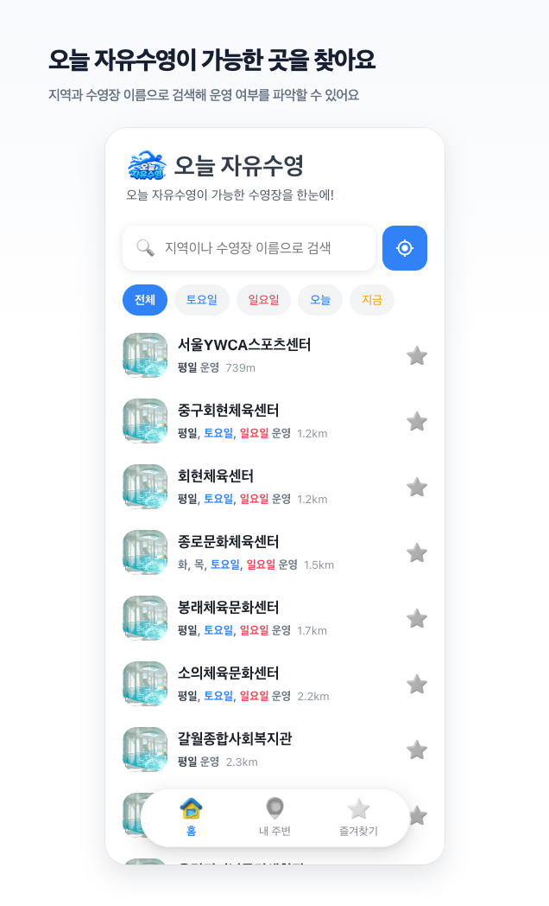
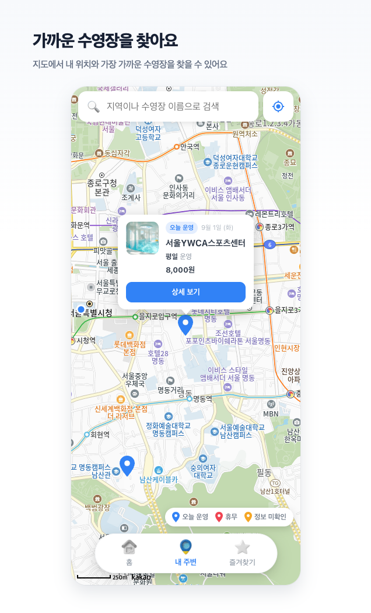
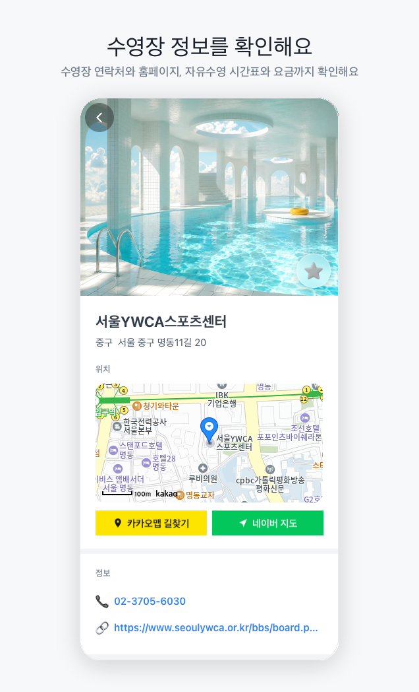

<div align="center">

# 🏊 오늘 자유수영 (Openswim)

**오늘 자유수영이 가능한 공공 수영장을 한눈에** — 지역과 내 위치를 바탕으로 오늘 갈 수 있는 수영장을 찾는 [AppsInToss](https://apps-in-toss.toss.im/) 미니앱

</div>

## 미리보기

<p align="center">
  &nbsp;
  &nbsp;
  
</p>

## 주요 기능

- 📍 **지역·내 위치 기반 탐색** — 구 단위 지역 검색 및 거리순 정렬 (위치 권한 미허용 시 기본 지역 정렬)
- 🗓️ **오늘 / 주말 · 공휴일 운영 판별** — 요일별 자유수영 시간표와 공휴일 테이블(`public.holidays`) 실시간 연동 (운영 / 휴무 / 정보 없음)
- 🚫 **이용 대상 제한 안내** — 여성 전용, 특정 연령 제한 등 헛걸음 방지를 위한 상세 제한 배지(`access_label`, `access_note`) 표시
- 🗺️ **지도 및 길찾기** — 카카오맵 지도 뷰, 수영장 위치 마커 표시 및 카카오맵·네이버 지도 길찾기 연동
- ⭐ **즐겨찾기 및 장비 추천** — 자주 가는 수영장 북마크, 추천 수영 장비 목록 제공

## 기술 스택

| 구분 | 스택 |
|------|------|
| **Frontend** | React 18 · TypeScript · Vite · Vitest |
| **Platform** | AppsInToss `@apps-in-toss/web-framework` 3.x (AIT) · TDS `@toss/tds-mobile` |
| **Database** | Neon Postgres + Neon Data API / Auth (REST, 익명 토큰) 단일 원본 |
| **Maps** | Kakao Maps JS SDK |

## 시작하기

```bash
# 1) 의존성 설치
pnpm install

# 2) 환경 변수 설정 (.env.example 참고)
# VITE_KAKAO_JS_KEY, VITE_NEON_DATA_API_URL, VITE_NEON_AUTH_URL 등
cp .env.example .env

# 3) 개발 서버 실행 (카카오맵 도메인 등록 일치를 위해 5173 포트 고정)
pnpm run dev

# 4) 테스트 및 린트
pnpm test
pnpm run lint

# 5) 빌드 (AIT 아티팩트 openswim.ait 생성)
pnpm run build
```

> **단일 원본(Single Source of Truth) 원칙**:
> 수영장 데이터는 **Neon DB가 유일한 원본**입니다. 로컬 JSON 폴백은 오래된 정보(휴장 시설을 '운영 중'으로 오안내)를 조용히 노출하는 위험이 있어 완전히 제거되었습니다. 조회가 실패할 경우 사용자에게 명확한 재시도 화면을 보여줍니다.

## 프로젝트 구조

```
src/
  screens/     홈 · 내 주변(지도) · 즐겨찾기 · 상세
  components/  SearchBox · PoolList · PoolMap · FavStar · RichText …
  lib/         pools(운영·공휴일 상태) · search(지역 검색) · geo · holidays …
  design/      tokens · primitives (토스 디자인 시스템)
  data/        gear.generated.json (추천 상품 정적 데이터)
scripts/       근거 자료 수집·검증, 월간 계획 OCR, 라이브 DB 감사·정리
evidence/      시설별 공식 근거 번들 (원본 HTML, 줄번호 텍스트, 스크린샷, OCR)
database/      Neon 스키마 마이그레이션 (database/migrations/)
docs/          앱인토스 정책, 데이터 정합성 감사 리포트, 미리보기 이미지
```

## 데이터 파이프라인 & 관리

수영장 데이터 조사는 공식 홈페이지/지자체 시설관리공단 사이트 조사를 원칙으로 합니다. (자세한 규정: `.claude/skills/korean-pool-research/SKILL.md`)

```bash
set -a; source .env; set +a

# 1) 공식 근거 수집 (원본 HTML, 텍스트, 해시/TLS 메타데이터)
pnpm evidence:collect

# 2) 근거 대조 및 OCR 추출
pnpm evidence:coverage                  # 본문 내 시간표 존재 여부 대조
node scripts/ocr-timetable-images.mjs   # 이미지 시간표 요소 크롭 OCR
node scripts/ocr-evidence-screenshots.mjs

# 월간 운영 계획 / 대체공휴일 공지 OCR (좌표 및 텍스트 추출, DB 직접 수정 안 함)
pnpm evidence:monthly-ocr --help

# 3) 검증 게이트 (출처·번들 무결성 검증, 통과 시에만 등록 진행)
pnpm evidence:verify

# 4) 신규 수영장 등록 (중복 방어선 및 트랜잭션 적용)
node scripts/insert-new-pools.mjs        # dry-run
node scripts/insert-new-pools.mjs --write

# 5) 라이브 DB 감사 및 정합성 정리
node scripts/audit-db-integrity.mjs      # 좌표·주소·요금 정합성 감사
node scripts/scan-duplicates-live.mjs    # 중복 후보 스캔
node scripts/classify-duplicates.mjs     # 중복 분류 (병합 / 판단 필요 / 오탐)
node scripts/cleanup-db.mjs              # DB 정리 (dry-run 후 --write)

# 6) 수영 장비 추천 데이터 동기화
pnpm gear:sync
```

### 데이터 규칙
- **요일 스키마 (`free_swim`)**: `0=일 … 6=토`, `7=공휴일`. 세션 배열이 비어있으면 해당 요일 휴무.
- **월간 계획 및 대체공휴일**: 공식 게시판 공지 확인 후 OCR 검토 데이터를 작성하며, 영구 주간 시간표와 날짜별 예외를 분리하여 다룹니다.
- **이용 제한 표기 (`access_label` / `access_note`)**: 여성 전용, 특정 연령 입장 불가 등 신분/성별에 따른 입장 제한만 배지로 노출합니다.

## 링크

- [Apps in Toss 콘솔](https://apps-in-toss.toss.im/) · [개발자 센터](https://developers-apps-in-toss.toss.im/) · [커뮤니티](https://techchat-apps-in-toss.toss.im/)

## 만든 사람

- [0rigin.space](https://0rigin.space)
